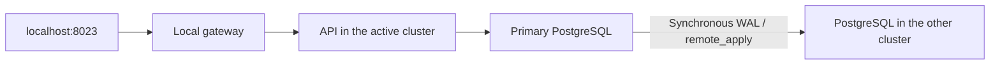

# Failover between two clusters

[Português](README.md)

The previous backup lab helped me recover a snapshot of the database. This exercise asks a different question: how do I move the application to another cluster, then move it back with the notes written during recovery?

The application is still the [docker-lab notes API](https://github.com/tommmdl/docker-lab). It runs in a dedicated namespace in each cluster. One PostgreSQL accepts writes; the other follows through synchronous physical replication. Before promoting the replica, the procedure closes the local route and confirms that the old application's and database's Pods have terminated. The old database returns on a new volume as a replica of the promoted database. Its previous volume is retained.



The same application and address follow both handovers. The gateway is a local process for the exercise, not a production load balancer.

## What the exercise covers

- Failover after a real API outage, fencing the previous writer and promoting its replica.
- Failback after writing new notes on the recovery cluster.
- Checking every row, ID, timestamp, sequence, schema and index after each handover. Sequence gaps are allowed; reusing IDs is not.
- Refusing promotion while the old writer exists and refusing writes on the standby.
- Interrupting the replica during a commit without treating a timeout as proof of rollback.
- Restarting the primary Pod and retaining previous volumes.

The test does not delete notes. Its sample notes remain available for inspection. Workloads, images and PVC identities in the other labs are compared before and after.

## Run locally

Use Linux or WSL with Docker, Python 3, kubectl and the existing `devops-notes` and `devops-recovery` kind clusters from the Kubernetes and disaster recovery labs. Keep the repositories next to each other. No Python packages are needed. The scripts use explicit contexts and kubeconfigs; they do not change the global context.

```bash
python3 scripts/lab.py init
python3 scripts/gateway.py
```

In another terminal:

```bash
python3 tests/verify.py
python3 scripts/lab.py status
```

Open [localhost:8023](http://localhost:8023). The test starts with side `a` active and ends in the same state. It can be repeated; each run adds notes with a distinct marker. `init` refuses existing namespaces or state.

For a manual handover after the tests:

```bash
python3 scripts/lab.py switch
```

This command alternates sides. Read the [procedure and recovery notes](docs/runbook.en.md) first. The setup uses NodePorts 30432 and 30433 in each cluster and discovers node IPs on the Docker `kind` network.

## What “without losing data” means here

With both databases connected, `remote_apply` waits for the standby to apply a commit before acknowledging a write. The test requires matching data after failover and failback, and retains old volumes. The application reopens only after the new replica becomes synchronous.

A handover needs administrative access to both clusters to confirm that the previous writer is fenced. If that cannot be confirmed, the procedure stops. There is no automatic election, quorum or external mechanism to power off an unreachable cluster. Both clusters share one machine: **host failure, lost disks, a complete partition and recovery from a destroyed cluster were not demonstrated by this lab**.

During promotion and replica rebuilding, the gateway returns unavailable and the API stays stopped. The promoted database briefly runs without a synchronous replica before traffic is released. Recovery needs available WAL and space for new volumes. This trades availability and recovery time for a procedure that can be inspected.

A connection failure or write timeout can happen after a local commit. The notes API has no idempotency key. The gateway never retries POST; the test records the uncertain outcome and checks the note after the replica returns. It does not promise exactly-once processing for arbitrary requests.

## Results and related work

All 48 checks passed locally and the same 48 passed in CI. The [local results](evidence/verification.json) and [test notes](docs/validation.en.md) record what actually happened. GitHub Actions creates two disposable clusters and runs the same exercise. Execution was assistant-assisted; repeating the procedure and explaining the decisions remain part of the learning work.

The Alpine images are the releases already adopted by the other labs, pinned by digest in [config/images.json](config/images.json). This lab does not change them or suppress findings: the analysis and Trivy snapshots remain in [security-lab](https://github.com/tommmdl/security-lab). A snapshot with zero reported findings is not a permanent guarantee.

Replication does not replace backup: an accidental deletion is replicated too. [backup-restore-lab](https://github.com/tommmdl/backup-restore-lab) and [disaster-recovery-lab](https://github.com/tommmdl/disaster-recovery-lab) still cover recovery through S3.

References: [PostgreSQL 17 synchronous replication](https://www.postgresql.org/docs/17/warm-standby.html#SYNCHRONOUS-REPLICATION), [pg_basebackup](https://www.postgresql.org/docs/17/app-pgbasebackup.html) and [promotion and failover](https://www.postgresql.org/docs/17/warm-standby-failover.html).
