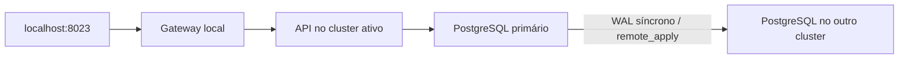

# Failover entre dois clusters

[English](README.en.md)

O backup do lab anterior me ajudou a recuperar uma fotografia do banco. Aqui a pergunta muda: como levar a aplicação para outro cluster e depois voltar, carregando também as notas escritas durante a recuperação?

A aplicação continua sendo a [API de notas do docker-lab](https://github.com/tommmdl/docker-lab). Ela roda em um namespace próprio em cada cluster. Um PostgreSQL recebe as escritas; o outro acompanha por replicação física síncrona. Antes de promover a réplica, o procedimento fecha o acesso local e confirma que os Pods da aplicação e do banco antigo terminaram. O banco antigo volta com um volume novo, como réplica do banco promovido. O volume anterior fica guardado.



A mesma aplicação e o mesmo endereço acompanham a ida e a volta. O gateway é um processo local para o exercício; não é um balanceador de produção.

## O que este exercício cobre

- Failover com indisponibilidade real da API, bloqueio do escritor anterior e promoção da réplica.
- Failback depois de gravar novas notas no cluster de recuperação.
- Conferência de todas as linhas, IDs, timestamps, sequência, estrutura e índices em cada troca. Saltos na sequência são aceitos; reutilizar IDs não é.
- Recusa de promoção enquanto o escritor antigo existe e recusa de escrita na réplica.
- Interrupção da réplica durante um commit, sem tratar timeout como prova de rollback.
- Reinício do Pod do primário e preservação dos volumes anteriores.

O teste não apaga notas. Os exemplos criados por ele ficam no banco para inspeção. Os outros labs têm seus workloads, imagens e identidades dos PVCs comparados antes e depois.

## Rodar no ambiente local

São necessários Docker, Python 3, kubectl e os clusters kind `devops-notes` e `devops-recovery` já criados pelos labs de Kubernetes e disaster recovery. Os repositórios ficam lado a lado. Não é preciso instalar pacote Python. Os contextos e kubeconfigs são explícitos; o script não troca o contexto global.

```bash
python3 scripts/lab.py init
python3 scripts/gateway.py
```

Em outro terminal:

```bash
python3 tests/verify.py
python3 scripts/lab.py status
```

A aplicação abre em [localhost:8023](http://localhost:8023). O teste deve começar com o lado `a` ativo e termina nessa mesma situação. Pode ser repetido; cada execução acrescenta notas com um marcador próprio. `init` recusa namespace ou estado já existente.

Para fazer uma troca manual depois dos testes:

```bash
python3 scripts/lab.py switch
```

Esse comando alterna entre os lados. Leia o [procedimento e os cuidados de recuperação](docs/runbook.md) antes de usá-lo. O fluxo usa NodePorts 30432 e 30433 em cada cluster e descoberta do IP dos nós na rede Docker `kind`.

## O que “sem perder dados” significa aqui

Com os dois bancos conectados, `remote_apply` espera a réplica aplicar o commit antes de confirmar a escrita. O teste exige igualdade dos dados depois do failover e do failback e mantém os volumes antigos. A aplicação só reabre quando a nova réplica está síncrona.

A troca exige acesso administrativo aos dois clusters para confirmar o bloqueio do escritor anterior. Se essa confirmação não for possível, o procedimento para. Não há eleição automática, quorum ou mecanismo externo para desligar um cluster inacessível. Os dois clusters estão na mesma máquina: queda do host, disco perdido, partição completa e recuperação de um cluster destruído **não foram demonstrados por este lab**.

Durante a promoção e a reconstrução da réplica, o gateway responde indisponível e a API fica parada. O banco promovido passa brevemente por um estado sem réplica síncrona, antes de liberar tráfego. A recuperação precisa de WAL disponível e espaço para volumes novos. Isso troca disponibilidade e tempo de retorno por um procedimento mais fácil de inspecionar.

Uma falha de conexão ou timeout de escrita pode acontecer depois do commit local. A API de notas não tem chave de idempotência. O gateway não repete POST; o teste registra o resultado incerto e confere a nota após a réplica voltar. Não há promessa de processamento exatamente uma vez para requisições arbitrárias.

## Resultados e continuidade

Os [resultados locais](evidence/verification.json) e o [relato dos testes](docs/validation.md) registram o que realmente aconteceu. O GitHub Actions cria dois clusters descartáveis e executa o mesmo roteiro. A execução foi feita com auxílio do assistente; repetir o procedimento e explicar as decisões faz parte do estudo.

As imagens Alpine são as versões já adotadas nos outros labs e estão presas por digest em [config/images.json](config/images.json). Este lab não altera as imagens nem esconde achados: a análise e as fotografias do Trivy continuam no [security-lab](https://github.com/tommmdl/security-lab). Zero achados em uma fotografia não é garantia permanente.

Replicação não substitui backup: uma exclusão indevida também é replicada. O [backup-restore-lab](https://github.com/tommmdl/backup-restore-lab) e o [disaster-recovery-lab](https://github.com/tommmdl/disaster-recovery-lab) continuam cobrindo a recuperação pelo S3.

Referências: [replicação síncrona no PostgreSQL 17](https://www.postgresql.org/docs/17/warm-standby.html#SYNCHRONOUS-REPLICATION), [pg_basebackup](https://www.postgresql.org/docs/17/app-pgbasebackup.html) e [promoção e failover](https://www.postgresql.org/docs/17/warm-standby-failover.html).
